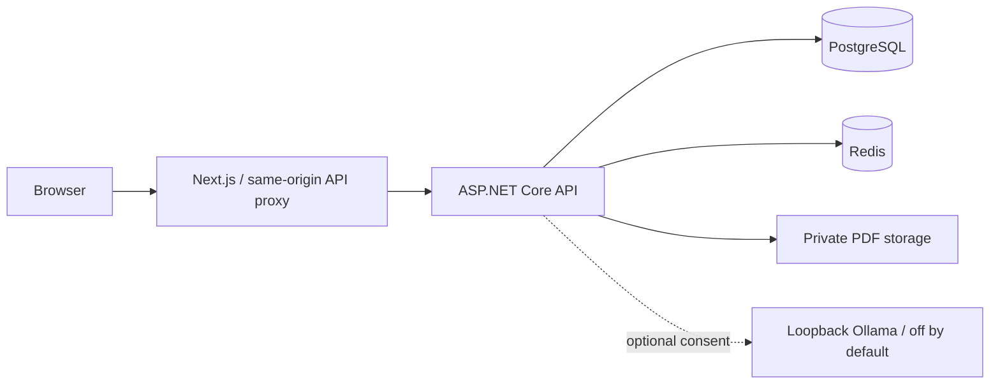
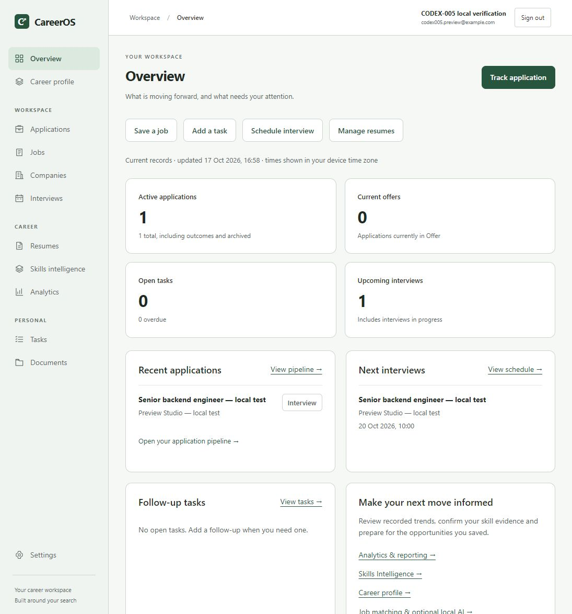

# CareerOS

[](https://github.com/Ekintaner/careeros/actions/workflows/ci.yml)

A private, self-hostable workspace connecting opportunities, applications, resumes, skill evidence, interviews and follow-ups. No paid API or mandatory cloud service.

**Final release scope: CODEX-001–015.** Local self-hosting is the delivery path. No public deployment or production certification is claimed. See [final verification](docs/verification-codex015.md) for results and limitations.

## Features

- Career profile, preferences and explicit skill evidence.
- Companies and opportunities with search, filtering and archive/restore.
- Application pipeline, stage history, private notes and resume assignment.
- Private PDF documents/resumes and primary resume selection.
- Deterministic weighted matching with explained matched/missing evidence.
- Skills intelligence and learning priorities from saved opportunities.
- Interviews with local/UTC date entry, private notes, tasks and due dates.
- Owner-scoped Overview and analytics with time-zone filters.
- Cookie authentication, rotating refresh sessions, CSRF and optimistic concurrency.
- Optional consent-based local Ollama assistance, **disabled by default**.

No automatic applications, job scraping, PDF parsing, email delivery, calendar invitations or push notifications are implemented. Password recovery fails safely until a delivery adapter is installed.

## Architecture and stack



Domain and Application contracts are implemented by Infrastructure and composed by Api. Owner-scoped queries and composite database constraints protect relationships. Redis is a readiness dependency; this diagram does not imply every operation is cached. Private files remain outside Git and the web root.

| Area     | Technology                                                                        |
| -------- | --------------------------------------------------------------------------------- |
| Web      | Node 24, Next.js 16.3.8, React 19.3, TypeScript, Tailwind 4                       |
| API      | .NET 8 / ASP.NET Core, EF Core 8, Npgsql                                          |
| Data     | PostgreSQL 17, Redis 7.4, private local PDF storage                               |
| Checks   | xUnit, PostgreSQL Testcontainers, Vitest/Testing Library, live HTTP/browser smoke |
| Delivery | npm workspaces, Docker Compose infrastructure, GitHub Actions                     |

.NET 8 reaches end of support on **10 November 2026**. Upgrade to a supported LTS before public production use; see [Microsoft's notice](https://devblogs.microsoft.com/dotnet/dotnet-8-9-end-of-support/).

## Windows quickstart with Docker

Use PowerShell 7. Install Node 24/npm 11, the .NET SDK in `global.json`, Git and Docker Desktop with Linux containers. Run from the repository root. Compose runs **PostgreSQL and Redis**; API and web run on the host. No full application container image is supplied.

```powershell
npm ci
dotnet restore apps/api/CareerOS.sln --locked-mode
dotnet tool restore
Copy-Item .env.example .env
# Edit .env and choose a private POSTGRES_PASSWORD before starting.
docker compose up -d --wait
```

The root `.env` is read by Compose only. Configure ASP.NET separately, using the chosen password and actual port:

```powershell
dotnet user-secrets set 'ConnectionStrings:PostgreSql' 'Host=localhost;Port=5432;Database=careeros;Username=careeros;Password=<your-local-password>' --project apps/api/src/CareerOS.Api
dotnet user-secrets set 'ConnectionStrings:Redis' 'localhost:6379' --project apps/api/src/CareerOS.Api
dotnet user-secrets set 'Auth:Issuer' 'careeros-local' --project apps/api/src/CareerOS.Api
dotnet user-secrets set 'Auth:Audience' 'careeros-web' --project apps/api/src/CareerOS.Api
$signingKey = [Convert]::ToBase64String([Security.Cryptography.RandomNumberGenerator]::GetBytes(32))
dotnet user-secrets set 'Auth:SigningKey' $signingKey --project apps/api/src/CareerOS.Api
$env:ASPNETCORE_ENVIRONMENT = 'Development'
dotnet ef database update --project apps/api/src/CareerOS.Infrastructure --startup-project apps/api/src/CareerOS.Api
dotnet run --project apps/api/src/CareerOS.Api
```

In a second terminal:

```powershell
Copy-Item apps/web/.env.example apps/web/.env.local
npm run dev
```

Open [CareerOS](http://localhost:3000) and register your own account. No seed/default credentials exist. API [readiness](http://localhost:5080/health) and Development [Swagger](http://localhost:5080/swagger) are local URLs. Full commands, POSIX equivalents and configuration: [development guide](docs/development.md).

For an optimized local preview, stop web development, run `npm run build`, then `npm run start --workspace apps/web`. This does not harden the Development API for public hosting.

## Configuration, privacy and operations

- [Configuration template](.env.example): Compose values and API setting names. Never commit real secrets. Web uses server-only `API_INTERNAL_URL` in `apps/web/.env.local`.
- [Release operations](docs/release-operations.md): clean install, migrations, paired backup/restore, upgrade/recovery and deployment choices.
- [Security review](docs/security-codex014.md) and [final audit](docs/verification-codex015.md): authentication, uploads, AI and operational limits.
- [Optional local Ollama](docs/local-ai-assistance.md): explicit enablement, cloud-disabled preflight and hardware caveats. No automatic model download.

Data lives in PostgreSQL and the API account's private PDF root. No analytics/AI SaaS or external job provider is required. Installation and optional model downloads need internet. Browsers/extensions, external links, administrators and an optional daemon have separate privacy boundaries. Use dedicated OS permissions; PDF signature checks are not malware scanning. Protect backups as sensitive data.

**Zero mandatory financial cost:** no paid API, database, domain, model or hosting subscription is required. Existing hardware, electricity and internet remain operator costs. No cloud resources are provisioned.

## Verification

```powershell
npm run format:check
npm run lint
npm run typecheck
npm test
npm run build
npm audit --omit=dev --audit-level=high
npm audit
dotnet format apps/api/CareerOS.sln --verify-no-changes --no-restore
dotnet build apps/api/CareerOS.sln -c Release --no-restore
$env:RUN_CONTAINER_TESTS = 'true'
dotnet test apps/api/CareerOS.sln -c Release --no-build
docker compose --env-file .env.example config --quiet
$env:CAREEROS_PREVIEW_URL = 'http://localhost:3000'
node --test scripts/http-hardening-checks.mjs
```

PostgreSQL tests use disposable containers/databases, not the development volume. Without opt-in they visibly skip; skips are not full coverage. See [test setup](docs/development.md#testing) and [synthetic performance methodology](docs/performance-codex014.md). Timings are local service/database measurements, not browser latency, real users or an SLA.

CI has separate **web**, **api** and **compose** jobs, read-only permissions and no deployment step. Use the final report's exact commit/run for release evidence.

## Troubleshooting

| Symptom                             | Action                                                                                                  |
| ----------------------------------- | ------------------------------------------------------------------------------------------------------- |
| Port conflict                       | Change matching ports/origins together; preserve existing volumes.                                      |
| Password failure after editing .env | Initialization variables affect new volumes only. Recover the correct credential; do not delete data.   |
| API configuration failure           | Supply connection strings, issuer, audience and random signing key. Compose .env alone is insufficient. |
| Readiness 503                       | Check PostgreSQL/Redis health, host ports and credentials.                                              |
| Windows build/install lock          | Stop this project's API/web process before rebuilding or npm ci, then restart.                          |
| Login/CSRF/routing failure          | Check exact frontend origin and API_INTERNAL_URL; restart/rebuild after changes.                        |
| Missing files after restore         | Restore database and private PDF root from the same backup pair.                                        |
| AI unavailable                      | Check optional preflight requirements; core features remain available.                                  |

## Explore and present

[Synthetic demo walkthrough](docs/demo-walkthrough.md) · [English/Turkish CV and LinkedIn text](docs/portfolio.md) · [Architecture](docs/architecture.md) · [Database](docs/database.md) · [Design system](docs/design-system.md)



`apps/web` contains UI; `apps/api` the layered API and tests; `docs` contracts and verification; `scripts` smoke helpers; `.github/workflows` CI. Historical reports are point-in-time evidence.

## License

[MIT](LICENSE).
