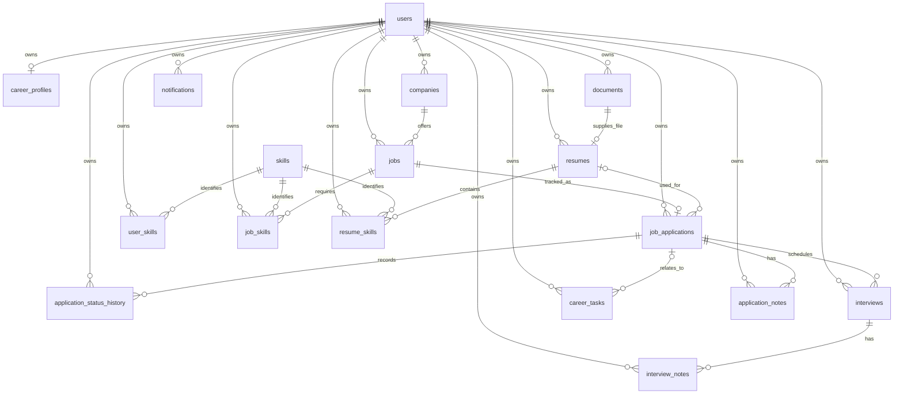

# Core domain and PostgreSQL architecture

CODEX-002 defines persistence and domain invariants; CODEX-003 adds credential/session persistence and server ownership boundaries. CODEX-004 implements profile/skills/account behavior; CODEX-005/006 implement companies, jobs and application tracking. Matching, uploads and notification delivery remain deferred. No seed data is installed.

## Entities and responsibilities

| Domain entity            | PostgreSQL table             | Responsibility                                                    |
| ------------------------ | ---------------------------- | ----------------------------------------------------------------- |
| User                     | `users`                      | Stable account ID, email/display name and authentication state    |
| CareerProfile            | `career_profiles`            | Optional one-to-one career information for a user                 |
| Company                  | `companies`                  | User's company record; names need not be globally unique          |
| Job                      | `jobs`                       | Opportunity belonging to a company, independent of an application |
| JobApplication           | `job_applications`           | One user's application to a specific job                          |
| ApplicationStatusHistory | `application_status_history` | Ordered, append-only domain status events                         |
| Document                 | `documents`                  | Object-storage metadata; no binary content                        |
| Resume                   | `resumes`                    | Named career resume referencing a resume-type document            |
| Skill                    | `skills`                     | Shared canonical skill vocabulary                                 |
| UserSkill                | `user_skills`                | User's skill, optional proficiency and experience                 |
| JobSkill                 | `job_skills`                 | Job's required/preferred skill                                    |
| ResumeSkill              | `resume_skills`              | Skill present in a particular resume                              |
| Interview                | `interviews`                 | Scheduled conversation linked to an application                   |
| CareerTask               | `career_tasks`               | Independent or application-linked task                            |
| ApplicationNote          | `application_notes`          | Text attached explicitly to an application                        |
| InterviewNote            | `interview_notes`            | Text attached explicitly to an interview                          |
| Notification             | `notifications`              | Future in-app message and read-state persistence                  |

Every standalone entity uses an application-generated UUID. CareerProfile uses UserId as its primary key; skill associations use composite primary keys. There is no generic BaseEntity or repository. Each entity protects its mutation methods with private setters; common validation and audit interfaces do not hide entity behavior.

## Relationships

The diagram describes relational cardinality; application creation additionally requires an initial Saved or Applied history event through the domain constructor.

## Ownership model

All user-owned rows have a required UserId FK to `users`. Skill is deliberately shared and contains no private career data. The user row is the account identity, not an authenticated principal implementation.

User-owned references use composite foreign keys: `(UserId, CompanyId)` references `(UserId, Id)` on companies, and the same pattern applies to jobs, applications, resumes, interviews, notes and skill associations. A valid foreign UUID belonging to another user is rejected by PostgreSQL. Optional application/resume references still have a separate required UserId FK, so NULL relationships cannot erase ownership.

Resume's document FK also includes DocumentType and a check requiring `Resume`. Its principal key is `(UserId, Id, Type)` on documents, so an unrelated user's document or a cover letter cannot be used as a resume. These alternate keys exist to support relational ownership checks, not as extra business identifiers.

DbContext rejects ownership mutation on tracked records. **This is not query authorization.** There are no global tenant filters or RLS policies. CODEX-003 HttpCurrentUser derives UserId from validated claims; OwnedData explicitly scopes product queries and guards writes. Authentication has narrowly scoped account/session queries. CODEX-004 allows authenticated insertion/search of validated shared vocabulary; canonical renaming/deletion remain unavailable. Owned skill metadata still requires OwnedData. Never serialize these entities directly as public API contracts.

## Normalization and uniqueness

- Email is trimmed and treated case-insensitively across the entire address. The domain accepts bare ASCII addresses (punycode domains work); provider-specific dot/plus alias transformations are intentionally absent. `EmailNormalized` is a stored PostgreSQL generated column with a unique index.
- Canonical skill names currently support printable ASCII, preserve punctuation such as `C#` and `.NET`, trim surrounding whitespace and fold ASCII A–Z to a–z. `NormalizedName` is generated by PostgreSQL using the same `translate` expression and uniquely indexed. Raw SQL cannot forge a different normalization value. Internal spacing remains significant. Unicode case folding, localization, aliases and synonym merging need a deliberate later migration rather than platform-dependent casing.
- Application uniqueness is `(UserId, JobId)` for the entire record lifetime, including archived records. Stage changes preserve one continuous history. Reapplying to a genuinely new posting should reference a new Job; multiple attempts against one Job require an explicit future model change.
- A filtered unique resume index on UserId where IsPrimary is true permits **at most one**, not exactly one, primary resume. Switching primary resumes requires a transaction: clear the old primary and save, then set the new primary and save, then commit. The database protects races; callers must handle uniqueness/concurrency conflicts.
- Document StorageKey is globally unique. DocumentId is unique in resumes: one metadata record cannot back multiple independently mutable resumes. A future resume version is a new resume/document pair.
- Profile and each explicit skill association have unique primary keys that prevent duplicate links. Application history has unique `(ApplicationId, Sequence)` ordering.
- Company names are trimmed and indexed per owner but are not unique: unrelated businesses can legitimately share a name or site. Future create flows can offer duplicate suggestions without turning them into a destructive database assumption.

## Domain and database constraints

Required values use NOT NULL; required text has a nonblank check and explicit length limits. URLs are limited to 2048 characters and HTTP(S); the domain rejects missing hosts and embedded credentials, and the database rejects obvious unsafe schemes, authority credentials and whitespace. URLs are metadata only—future server-side fetching requires separate SSRF controls.

Salary amounts use `numeric(14,2)`, never floating point. They must be nonnegative and ordered. Any amount requires a three-letter uppercase currency code and an explicit hourly/monthly/yearly period. With no amounts, currency and period must both be absent. The domain rejects excess fractional precision; PostgreSQL numeric follows its usual rounding rules for raw SQL. Full ISO currency membership is deferred to real input validation.

Other constraints include nonnegative file size, 0–100 years of experience with one decimal place, job expiry not preceding posting, positive interview duration, audit/update ordering, completion/read time not preceding creation, valid enum strings, status revision nonnegativity and distinct from/to statuses. String lengths and numeric precision live in individual `IEntityTypeConfiguration<T>` classes. A small mapping helper centralizes repeated audit, FK and scalar constraints.

Enums are stored as readable strings with explicit CHECK lists, not PostgreSQL native enums or UI order numbers. Reordering C# enums does not rewrite stored meaning. Renaming an enum member is a database compatibility change and requires a migration.

## Application history and workflow

Creating a JobApplication records its selected initial Saved or Applied status at sequence 0 with FromStatus NULL. `TransitionTo` appends a history row, advances StatusRevision, records LastStatusChangedAtUtc, updates Status and records the first AppliedAtUtc. Equal server timestamps remain ordered by Sequence. Backwards server time, repeated states and unsupported transitions are rejected before mutation.

CODEX-006 supports backward movement among Applied/Assessment/Interview/Offer, explicit terminal outcomes, archive and restore to the recorded pre-archive stage. See the complete [transition policy](applications-and-pipeline.md). Reopening terminal outcomes and importing backdated events remain deferred. Application changes and their new history event use one EF transaction; xmin and sequence uniqueness reject races without extra events.

History exposes no mutation methods and DbContext rejects modifications/deletions. Database FK/check/unique constraints protect relationships and event shape; there is no trigger validating the entire event chain or synchronizing raw SQL status edits. Administrative SQL and bulk EF updates bypass aggregate behavior and must not be used for workflow changes. A later privileged erasure/import tool will need its own explicit audit policy.

## Timestamps and concurrency

All persisted date/time properties use PostgreSQL `timestamp with time zone`. Npgsql materializes them as UTC DateTime values. The domain rejects local/unspecified business timestamps, and DbContext checks timestamps again before saving.

DbContext sets CreatedAtUtc/UpdatedAtUtc from a server TimeProvider for both synchronous and asynchronous saves. Incoming created timestamps are overwritten for inserts and restored to their original tracked value on updates. Completion/read events are stamped at save time, including records completed/read before first persistence. Business schedules and posting dates can be supplied as validated UTC values; status changes use a server clock. Database insert defaults support controlled SQL insertion, but **raw SQL and ExecuteUpdate do not run DbContext audit handling**. There is no audit trigger or browser-supplied authoritative clock.

Mutable entities and metadata-bearing joins use PostgreSQL's `xmin` as an EF shadow row version. It provides optimistic lost-update protection without a custom distributed lock. Future command handlers must load the row, apply domain behavior, and handle `DbUpdateConcurrencyException`; disconnected blind updates are not a supported editing workflow. See [Npgsql concurrency documentation](https://www.npgsql.org/efcore/modeling/concurrency.html?tabs=fluent-api).

## Indexes

Primary/alternate keys and unique indexes enforce the relationships above. Foreign-key indexes are generated where an existing leading index does not already cover the relationship. Additional query indexes are deliberate:

| Table                               | Query indexes                                                         |
| ----------------------------------- | --------------------------------------------------------------------- |
| companies                           | UserId, Name                                                          |
| jobs                                | UserId, CreatedAtUtc; UserId, PostedAtUtc; ownership/company FK       |
| job_applications                    | UserId, Status, CreatedAtUtc; UserId, CreatedAtUtc; job/resume FKs    |
| application_status_history          | ApplicationId, ChangedAtUtc, Sequence; unique ApplicationId, Sequence |
| interviews                          | UserId, ScheduledStartUtc; application FK                             |
| career_tasks                        | UserId, DueAtUtc; UserId, CompletedAtUtc; optional application FK     |
| documents / resumes                 | UserId, CreatedAtUtc; storage/document uniqueness                     |
| application_notes / interview_notes | UserId, parent ID, CreatedAtUtc                                       |
| notifications                       | UserId, CreatedAtUtc plus an unread-only partial index                |
| skill associations                  | Composite relationship PKs and SkillId FK indexes                     |

No standalone timestamp index is added for an unscoped cross-user dashboard. Query plans, workload-driven full-text search and trigram indexes are deferred until real query patterns exist. See [PostgreSQL constraints](https://www.postgresql.org/docs/current/ddl-constraints.html).

## Delete behavior

Every FK uses RESTRICT. User deletion cannot cascade through career history. Companies with jobs, jobs with applications, documents used by resumes, resumes used by applications/skills, and applications/interviews with dependents cannot be silently deleted. No implicit SET NULL removes application context. Leaf rows can be explicitly removed except immutable status history through the normal DbContext. There is no generic soft-delete column or hidden global filter. Job/application archiving is implemented; account erasure and retention workflows remain deferred.

## Resume/document distinction

Document owns immutable original filename, storage key, MIME type, byte size and classification; its display name can be renamed. Resume owns the career-facing name and primary selection, references exactly one resume-type Document, and participates in application and skill relationships. This avoids two sources of truth for file metadata. No binary content, extraction result, upload behavior or object-store SDK is added.

## Matching and notifications

JobMatchAnalysis is intentionally deferred. Without a real scoring contract, algorithm/input versioning and explanation representation, persisted percentages would be misleading. The job/profile/resume skill relationships provide the foundation without speculative score columns or JSON blobs. Notification is only a user-owned message with a free-text type and idempotent read behavior; there is no delivery infrastructure.

## Migration and verification workflow

The first real migration is `20260919231621_InitialDomainSchema`, generated through `dotnet ef`, with a matching model snapshot. Apply it explicitly using the commands in [development](development.md); API startup never migrates or seeds a database. Review generated SQL before deployment. Migration rollback drops the schema and is only appropriate for disposable test databases or an explicitly approved recovery plan.

The PostgreSQL test fixture creates a new randomly named database per test and deletes only that database afterwards. CI opts into Testcontainers. For local testing without Docker, `CAREEROS_TEST_POSTGRES` may point to a **disposable PostgreSQL server** with CREATE DATABASE permission; tests create/drop their own `careeros_test_<uuid>` databases and never reset the supplied database. Never point test configuration at production. Neither test mode substitutes an in-memory provider.

Coverage includes migration/apply/rollback/reapply, schema/index inspection, all cross-owner dependent references, deletion restrictions, normalized uniqueness, application/profile uniqueness, primary-resume switching, check constraints, UTC/audit handling, atomic history and xmin concurrency. Authentication and ownership-boundary integration coverage are documented in [authentication](authentication.md). Profile/skills/account behavior is covered in [profile](profile.md); other product CRUD remains deferred.

## CODEX-004 preferences

`20260920091054_CareerProfilePreferences` adds four default-empty bounded arrays to career_profiles: TargetRoles, PreferredLocations, EmploymentTypes and SeniorityLevels. Database checks enforce cardinality, null/empty element restrictions, one dimension and existing enum membership. Text columns constrain element length; application validation trims and deduplicates entries. A varchar_pattern_ops index supports canonical skill prefix lookup without altering the unique generated normalization index. The total remains 19 tables. See [profile](profile.md) for ownership, concurrent canonical creation, row-version contracts and migration verification.

## CODEX-003 migration

`20260919234449_AuthenticationFoundation` adds nullable password hash, email-verification timestamp and last-login timestamp, plus a security stamp to users. Existing IDs and career rows remain intact; pre-authentication accounts have no usable credentials until recovery establishes a password.

Two tables bring the total to 19: refresh_tokens (one hashed generation per rotation, user/family/replacement metadata) and password_reset_tokens (hashed expiring single-use tokens). Both have unique hash and expiry indexes and RESTRICT ownership FKs. Refresh replacements use a composite user/family/ID FK; CHECKs enforce digest shape, expiry/revocation ordering and replacement revocation. No raw persistent token, user-agent or IP is stored. See [authentication](authentication.md) for locking, absolute expiry, replay and retention requirements.

The generated migration is tested on a clean database, after InitialDomainSchema containing an existing user, on rollback to InitialDomainSchema, on complete rollback and on reapplication. InitialDomainSchema remains unchanged.

## CODEX-005 lifecycle

The generated 20260920101042_CompanyAndJobLifecycle migration adds nullable jobs.ArchivedAtUtc (timestamp with time zone). Existing jobs remain active; rollback removes only archive markers. Nineteen tables and existing indexes/RESTRICT ownership foreign keys remain intact. Company names still deliberately allow duplicates. Company/job services use owner-scoped projections, bounded offset pagination and xmin versions. See [companies and jobs](companies-and-jobs.md).

## Application lifecycle migration (CODEX-006)

20260927184616_ApplicationTrackingLifecycle broadens only the initial history CHECK from Saved to Saved/Applied. All 19 tables and existing ownership/sequence/expiry indexes remain. Rollback deliberately fails if direct-Applied initial events exist; do not fabricate history to force rollback. See [application persistence](applications-and-pipeline.md).
