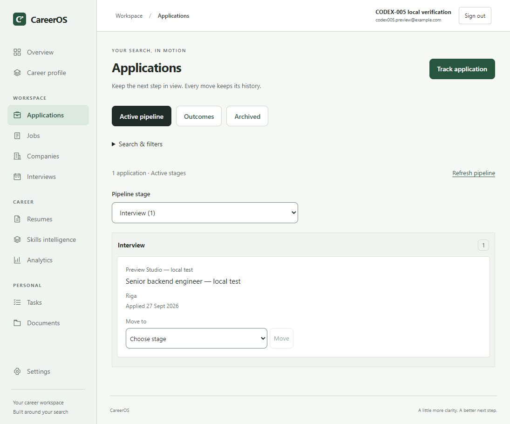
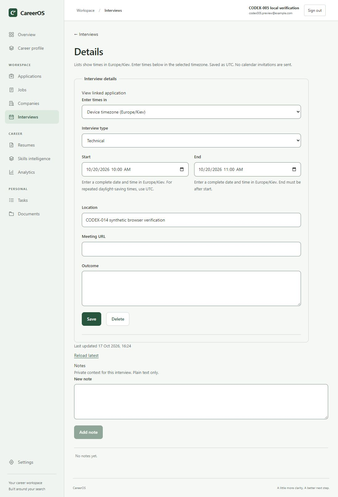
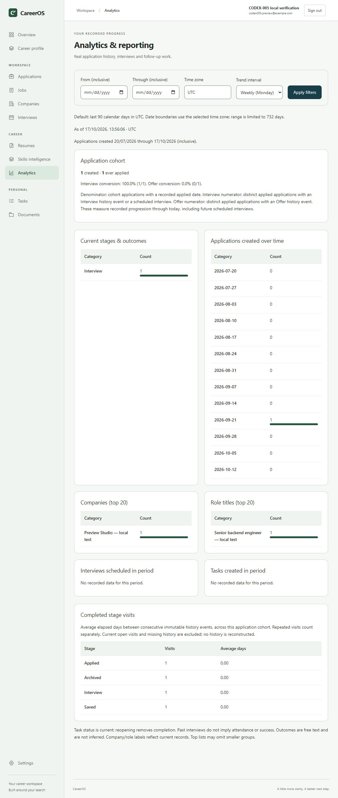
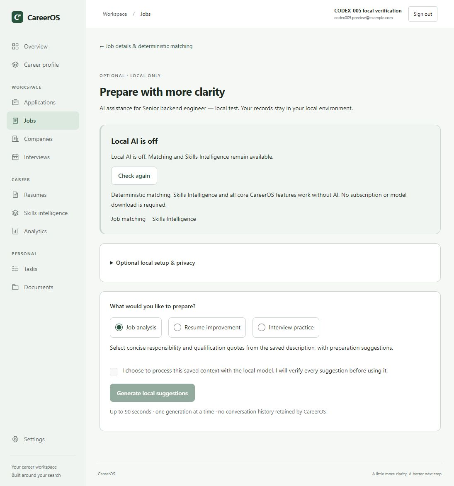

# Synthetic demo walkthrough

Allow 5–8 minutes. Use only a dedicated local demo account. Never record a personal workspace, real resume, email inbox, employer interview notes or credentials. No invitations or external applications are sent by these steps.

## Reproducible demo data

On a fresh install register an account you control, with display name **Synthetic portfolio demo**. Do not share its password. Create the following manually through the UI; no seed/import script runs against existing user data.

| Record           | Synthetic value                                                                                                                               |
| ---------------- | --------------------------------------------------------------------------------------------------------------------------------------------- |
| Company          | Preview Studio — synthetic demo                                                                                                               |
| Job              | Backend engineer — synthetic demo                                                                                                             |
| Description      | Fictional portfolio scenario. Build an ASP.NET Core API using PostgreSQL; write tests and document recovery. This is not an open job posting. |
| Skills           | Required: PostgreSQL, ASP.NET Core; preferred: Docker                                                                                         |
| Profile evidence | Add only synthetic demo skills in this demo account; these are not the operator's qualifications.                                             |
| Application      | Track the fictional job as Applied, then transition to Interview                                                                              |
| Interview        | Technical, 20 October 2026 07:00–08:00 UTC; location “Synthetic demo — no meeting”                                                            |
| Task             | “Synthetic demo — prepare API design discussion”, Normal priority                                                                             |
| Resume           | Optional PDF containing only “Synthetic demo — not a candidate CV”; never upload a real person's CV for screenshots                           |

The fixed interview date is for reproduction of this release. For a future presentation use a future date and state its timezone; do not change historical evidence to claim a new test. Empty states are valid: never fill analytics with fabricated business outcomes.

## Demonstration sequence

1. Explain the privacy/cost model on Overview: local product data, optional AI off, no paid API.
2. Show the fictional company/job and explicit requirements. Open deterministic matching; distinguish profile evidence from confirmed resume skills and explain a missing skill.
3. Track the job, change a stage and show immutable history/notes. In compact pipeline view select Interview to reveal the fixture card.
4. Open the interview. Explain the displayed timezone, change entry to UTC, save and reload. Show invalid end-before-start feedback without changing the fixture's final valid dates.
5. Create a synthetic follow-up task; show due/completion state. Discuss private PDF storage and the paired backup requirement without opening a real document.
6. Open Skills intelligence and Analytics. Explain recorded-data denominators and that a one-record 100% conversion is not hiring performance evidence.
7. Open optional local AI assistance from job detail. Show **Local AI is off** and unavailable generation. Do not enable/download a model during this walkthrough.
8. End with tests, operations documentation and honest limits: local deployment, missing email adapter, PDF signature checks, .NET support deadline and untested physical devices/screen readers/model quality.

## Real screenshot assets and provenance

Captured 2026-10-17 from the optimized local web build and actual API/PostgreSQL. The existing account is visibly labelled `CODEX-005 local verification`, uses the reserved example.com address, and contains labelled local-test fixtures from earlier phases. No user record was repurposed. Interview fixture `96f12d99-9262-4324-9a75-17ad9223236d` is the approved synthetic CODEX-014 date regression fixture. Screenshots are unretouched browser captures, not generated mockups. No password, cookie, signing key, private PDF or real contact is shown. These are a small representative fixture, not a large adoption/customer dataset.

For performance-scale synthetic data use `HardeningPerformanceTests` with the documented opt-in in [performance methodology](performance-codex014.md). It seeds disposable test databases, not this local demo account. See the [final verification](verification-codex015.md) for fresh raw samples and test scope.
